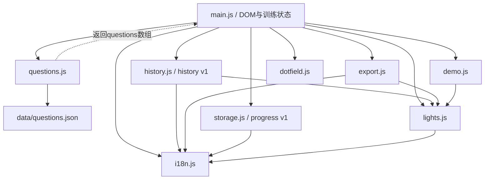
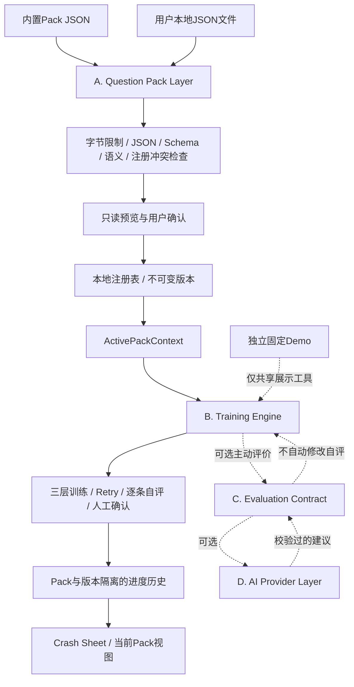

# Stage 1 — 现有架构审计与目标边界

状态：下文为Stage 1架构审计；Stage 1.1/2A增量见文末，仍未接入运行时。审计日期2026-11-18。
基线：`0c09c60ba6ff6a41fc73168d9809b12c2d0a5287`，main，审计开始工作树干净。继续任务时发现基线已从61e45e9推进，以下以最新源码为准。既有测试37/37通过。

## 实际检查的文件与证据

| 文件/符号 | 当前真实行为 | 最小后续改动 |
|---|---|---|
| src/questions.js：loadQuestions/validateQuestions | fetch固定data/questions.json；顶层非空数组、数组内ID唯一；固定L1/L2/L3顺序；rubric是2–4个字符串；要求title_en/prompt_en/rubric_en | 增加独立Pack解析/校验边界，旧加载器暂保留，最后经适配器切换入口 |
| data/questions.json | 同一个题库数组内3题9层，JUC/Redis/MySQL分类，不是3个已注册Pack | 用明确转换清单生成Pack副本，不原地覆盖 |
| src/main.js：boot/current/renderLayer/fillRubric | 主流程拿questions数组，按id选择并从当前layer取得rubric；无Java/Redis/MySQL分支 | 只调整数据入口、上下文及键构造；保留提交/Retry/确认自评事件，不整体重写 |
| main.js：key/cellKey/drafts | questionId::Lx作为草稿和当前记录身份，无pack或版本 | 引入唯一上下文key函数；草稿/当前选择/异步结果都带pack版本 |
| main.js：confirm-rating | 逐要点灯号聚合，手动确认后store.rate和log.add分别写两个存储 | 不改变“人确认才写入”；后续将同次确认写入单个v2状态快照，避免两个键写入部分成功 |
| src/storage.js | unscripted.progress.v1，仅status/updatedAt；读坏数据退内存，rate/clear写整个对象 | 保留原始v1，新增v2适配；旧clear不可用于新迁移流程 |
| src/history.js | 新增unscripted.history.v1，最多200条；可选保存answer；pointLights/missedPoints依赖rubric数组位置；latestByCell按插入顺序 | 必须同时隔离Pack、版本及rubricId；保留隐私开关。当前parseHistory会过滤无效条目，迁移不得用它静默丢弃原始信息 |
| src/export.js | 显式接收questions/progress/lang/entries；按questionId::layer过滤review，按missedPoints下标索引当前rubric | 保持纯函数与Markdown转义；改为明确当前Pack/version的进度与历史视图，按rubricId取要点 |
| src/i18n.js | UI字典与zh/en偏好；localized通过field或field_en分支选题目内容 | UI字典保留；新增Pack语言解析函数读取语言映射，不把所有题库文案塞回UI字典 |
| src/lights.js | 通用绿/黄/红聚合；仅green映射pass；suggestions Map也只按questionId::layer索引 | 保留灯号算法/DOM工具；建议缓存增加完整上下文和rubricId，不能直接信任旧数组建议 |
| window.Unscripted.suggestLights | main.js暴露的建议钩子；没有真实AI；仍需用户采纳/确认 | 将来Provider返回先过Evaluation验证，再映射当前要点，校验请求身份/长度；暂不扩展公开API |
| src/demo.js | 当前已改为首页固定灯号序列动画；只用lights的DOM工具，无正式存储/网络调用 | 保持独立演示；不要误写成旧版独立英文答题面板，也不要让用户Pack覆盖Demo状态 |
| src/dotfield.js、styles.css | 纯视觉/动效，非题库来源 | 不动 |
| index.html、i18n示例文案 | Java案例仍在首页展示，属于固定产品示例 | 可以保持固定并标清示例；不得声称它随当前Pack切换，训练主流程无领域分支 |
| tests/*.test.mjs | 7个测试文件：questions/storage/export/i18n/lights/history/dotfield，37项 | 保留；下一阶段追加Pack与迁移测试 |
| README、规划三文件 | 仍有零代码/比赛日期/旧AI契约等历史叙述，与当前阶段不同 | 将旧计划明确归档，新Stage计划作为唯一当前入口 |
| tools/package_site.py、.github/workflows/pages.yml | 显式打包12个资源；push main会部署，docs/work均不在白名单 | 本轮不改白名单，文档提交使用[skip ci]，不部署实验内容 |

## 当前依赖图（实线表示源码import或调用）

## 冻结的目标四层（逻辑边界，不要求四套框架）

A管理内置/导入来源、格式验证、预览、显式激活、已导入版本清单和卸载；不得包含训练答案状态。首版只导入本地JSON，不支持任意URL抓取、远程代码或Pack指定API地址。内置ID受保护，用户导入同ID不可覆盖内置题库。

B只接受已经验证的`ActivePackContext={packId,packVersion,contentDigest,contentLanguage,questions}`及适用版本的进度视图。取题、分类、三层顺序、rubric遍历只读数据；不判断领域名。可以继续用main.js编排，不为架构图重建路由/事件总线。切Pack先告知会清空未保存草稿；确认后清除/隔离该会话草稿、pending建议、选择和当前渲染；将来请求需取消或丢弃旧上下文结果。

C是可验证的数据契约，见QUESTION_PACK_SCHEMA_V1.md；它不知道厂商HTTP格式，不读写localStorage。D只负责供应商传输与响应转换，不决定pass、不管理题库。无Provider时B完整运行且不伪造评价对象。

## 最小接口草案（设计，不是已创建文件）

- `parseAndValidatePack(rawBytes) -> {ok, pack?, errors:[{path,code,message}]}`：一次性全包校验；不写存储。
- `previewPack(pack) -> {identity, counts, languages, reviewClaims, conflicts}`：只读，无执行代码/自动激活。
- `registerPack(pack, confirmation) -> immutableVersionRef`：同ID同版本同规范化内容为幂等；内容不同为冲突；新版本必须确认。
- `activatePack(ref) -> ActivePackContext`：完整校验/存储成功后才替换当前上下文；失败继续旧题库。
- `getProgress(context)/recordSelfRating(context, rubricResults)`：存储只认完整身份；不接受AI直接调用。
- `buildCrashSheet(context, progressView, historyView, language)`：沿用现有纯函数方向，禁止把所有Pack进度直接传给旧函数。
- `provider.evaluate(input, {signal, credential}) -> Promise<output>`：仅预留文档；credential独立内存参数，不进入input、Pack、日志或输出。错误类别auth/rate_limit/network/timeout/provider/invalid_output/aborted，HTTP细节由适配器去敏。

## 问题与边界

新增history是本次发现的实质风险：仅迁移progress会遗失逐要点灯号关联，并可能让历史覆盖当前显示。先设计一致迁移，不修改现状。现有模型建议数组缺少Pack/版本/答案标识，未来必须封住此处，不能直接当已存在Provider接口。

本轮没有前端代码变更，不需要为文档重做视觉测试；已运行源码基线测试。结构校验、来源记录和翻译对应均不证明知识正确。人工审校仍未完成。

完成复核：同期视觉工作推进到f92cc82；最新测试38/38通过。上述训练/数据边界未因其改变；本Stage不包含同期页面实现。具体提交归属见测试记录。

## Stage 1.1 / 2A增量（基线f254eea）

独立校验API落实在src/packs/validate.js，取代上文parseAndValidatePack草案命名；返回valid而非ok，见Schema说明。strict-json.js仅负责安全解析，semantics.js负责结构无法表达的约束。两项npm开发依赖不进入现有12资源发布白名单。原questions.js/main/storage/history/export/Demo调用图不变。

Pages同一deploy job新增Node24→npm ci→npm test→语法检查，之后才使用原Python白名单打包。保留permissions/concurrency，未增加continue-on-error；失败会阻止后续打包和部署。新工作流未提交，所以远端CI尚未运行。迁移/删除/JCS仅修订规范，没有可调用实现。
