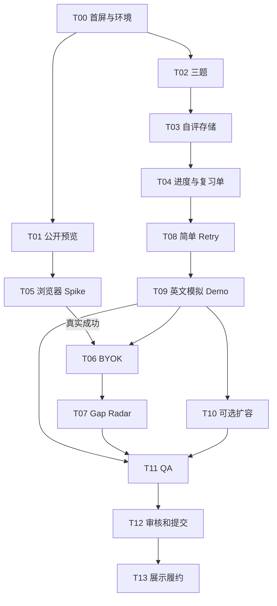

> 历史归档：不作为当前执行指令；当前入口为上级MASTER_PLAN.md。

# Unscripted｜主计划

版本：2026-11-14 v2（第 18 节完整交付版）。当前已推进题库、手动练习、自评存储、复习单、Retry 与英文模拟 Demo；具体完成状态、验收限制只维护在 TASKS.md 和 QA_REPORT。

执行摘要：从零完成 3 题、无 Key 手动闭环、独立英文模拟 Demo 和提交材料有条件可行，不能承诺时间。P0A 优先；P0B 只有实际浏览器 API 通过且核心稳定才投入。保底预计 16–28 小时专注工作，另留缓冲；11/18 冻结功能，11/20 目标提交。CORS 失败停止 Live 扩张，不加代理、不伪造 AI。模型分工继续采用 Sol 主执行、Astra 检查点、Luna 有限可选工作。

## 1. 新执行者先读这里

目标：为软件学习者创建纯前端解释训练网站，完成“回答 → 对照 rubric/AI 反馈 → 再解释 → 手动自评 → 当前复习单”。标语：AI can write your code. Can you explain it?

基线：用户确认截至 2026-11-14 为零代码。没有可复用题库、仓库、旧数据或迁移任务。工具安装、账户权限、API 可用性尚待实测。

执行入口：先读本节、TASKS.md 的“当前状态”和当前任务卡，再按需读取 DECISIONS.md 中引用的决策。任务卡中的项目路径以未来项目根目录为相对起点，不代表文件已存在。

原始参考：用户提供的《Unscripted_Astra_从零开发规划交接书_v2_2026-11-14.md》。用户后续明确要求的模型分工、最多两个子 Agent、先交付再有限并行优先。本轮用户已明确要求执行附件第 18 节的规划输出；仍未要求一次性实现产品。

本次三文件存放在 outputs；正式启动时由主执行者复制进项目 docs/planning，并将该位置设为唯一维护源，停止双份同步。建议新项目目录为当前工作区下 unscripted；创建前检查路径，不能覆盖其他工作。

## 2. 最经济的交付路线

默认 Sol 作为日常主 Agent，一次执行一个可验收阶段。Astra 负责规划、关键审查与复杂故障，不承担常规页面、CSS、题库录入和简单测试。默认不启用 Subagent。

最低版本必须包含：3 道审校技术题、每题三层、回答后查看参考要点、人工 pass/review、本地最新记录、最小 Depth Meter、一次手动 Retry、当前 review 的 Markdown 导出、独立英文 Simulated Demo、公开 HTTPS 网站、README 与提交材料。目标 6 题不阻塞提交。

目标版本仅在 API Spike 成功且尚有时间时增加：浏览器 BYOK、rubric 漏点、最多一条有效原文证据、一个追问、真实 AI 线索进入复习单。先做手动闭环和英文 Demo，再集成 AI；公开部署和 API 可行性验证仍需提前。

不做：框架迁移、后台、数据库、登录、代理托管 Key、产品内部多 Agent、RAG、排行榜、强制计时、禁止粘贴、能力分数、全题库翻译、20 题硬目标。

## 3. 架构与最小契约

HTML + CSS + 原生 JS ES Modules；通过 HTTP 加载本地 JSON，无构建工具要求。GitHub Pages 优先，但需现场确认发布权限；不可因部署工具不通擅自改造成后端服务。

按任务创建文件，不预先搭空壳：

```text
index.html / styles.css
data/questions.json
src/main.js / questions.js / storage.js / export.js / demo.js
src/ai.js                      # 仅条件性 Live 阶段
tests/                         # 有意义的数据、存储、导出、响应校验测试
docs/planning/{MASTER_PLAN,TASKS,DECISIONS}.md
docs/{SETUP_REPORT,QUESTION_REVIEW,API_SPIKE_REPORT,QA_REPORT}.md
docs/{SUBMISSION,DEMO_DAY}.md
README.md / .gitignore
```

页面区域：产品说明与 Practice/Demo 入口、分类/题目、三层条、首次回答、提交后参考要点、可选 AI 设置/反馈、Retry 对照、自评、复习单。未实现入口禁用并说明。

题库：数组；题目字段 id/category/language/title/layers；layers 恰好按 L1/L2/L3 排列，每层 id/label/prompt/rubric，rubric 为 2–4 条可核验字符串。题目 ID 唯一。首批建议 volatile 与复合操作、缓存穿透/击穿区分、数据库事务的一项明确机制；知识点须查可靠技术资料并请用户验收，不将模型初稿称作人工审校。

状态：会话中保存当前题层、草稿、Retry、Key、反馈和 Demo 状态。localStorage 键 unscripted.progress.v1，结构 {schemaVersion:1,items:{"题目ID::L2":{status:"review",updatedAt:"ISO时间",ai?:{source:"live",missing:[],followup:"..."}}}}。只有用户自评更新 status；AI 摘要需用户同意保留，缺省不持久化。默认不保存回答全文和 Key。

事件流：选择题层 → 输入 → 提交本次回答 → 查看 rubric 或主动 Ask AI → 可选 Retry → 用户自评 → 持久化 → 导出当前 review。pass 替换 review 后必须从复习单移除。

正式练习与 Demo 使用隔离的内存状态；Demo 不写正式存储、不发 AI 请求，每个反馈区域持续标注 Simulated example — no live AI call。

AI：候选 endpoint/model 仅来自原规划，未验证。只发送当前题层、rubric、回答；Key 只在内存，明确会发给选定供应商。优先固定经验证的 HTTPS endpoint；首版不开放任意地址配置。约 20 秒超时、防重复请求、切换题层或改答后丢弃旧反馈；所有动态文本安全渲染。

响应：missing 字符串数组，evidence_gaps 最多一项 {quote,issue,rubric_index}，followup 一个字符串，suggestion 为 pass/review，comment 字符串。索引约定从 0 开始且必须有效；quote 必须是该次回答连续子串，不符合则不展示证据。非法 JSON/类型回退自查。AI 建议绝不修改自评。

## 4. 日期与依赖

以下为内部安排，不是工时保证。本轮已重新打开官方规则与日程：正式截止为 11/21 23:59 EST，即 11/22 12:59 北京时间；Demo Day 为 11/24 EST，具体时刻未核实。内部目标为北京时间 11/20 提交，11/21 留补救时间。官方来源与 Discord 缺口见 §9；发布和正式提交前只检查规则有无更新，不重复无关调研。

| 日期 | 阶段与产出 | 负责人 |
|---|---|---|
| 11/14 | T00 最小页面、Git、环境报告；启动 T02 | Sol |
| 11/15 | T01 公开预览；T02–T04 手动闭环 | Sol |
| 11/16 | T08 手动 Retry、T09 英文 Demo；T05 限时 API Spike | Sol |
| 11/17–18 | 条件性 T06–T07；有余量再 T10 扩至 6 题 | Sol，可选 Luna |
| 11/18 晚 | 功能冻结，Astra 只处理重大未决风险 | 主执行者 |
| 11/19 | T11 QA、可选真实试用；材料整理 | Sol，可选 Luna |
| 11/20 | T12 交付审核、视频、正式提交目标 | Astra 审核；Sol/用户执行 |
| 11/21 | 处理提交阻塞、最终确认；不开发新功能 | Sol/用户 |
| 提交后至官方展示时间 | T13 Demo Day 准备与履约 | Sol/用户 |

依赖：T00 → T02 → T03 → T04 → T08 → T09 → T11 → T12 → T13。T00 → T01 → T05；T05 成功且核心稳定 → T06 → T07 → T11。T02 → 可选 T10 → T11。箭头表示依赖，不表示必须启用并行 Agent。

停损：11/15 晚仍无手动闭环，取消扩容/装饰，压到 3 题；11/18 晚仍有核心缺陷，停止 Live 新增功能，冻结为手动+模拟版本。T05 主动排查预算 60–90 分钟；没有有效 Key 则记未测试，不记失败。服务端不支持 CORS 时停止重试，不加代理。服务端 curl 成功不等于浏览器通过。

## 5. 模型职责与可用性

| 角色 | 任务 | 使用方式 |
|---|---|---|
| Astra | 范围/架构冻结、Live 边界争议、复杂故障、最终交付审核 | 按检查点介入，不常驻协调 |
| GPT-6.1 Sol | 环境、编码、集成、页面、存储、测试、API、部署、修复 | 默认唯一主执行者 |
| GPT-6 Luna | 稳定 MVP 之后的独立题库候选、英文材料初稿、只读局部检查 | 只有节省的主线时间超过交接成本才启动 |

推荐主 Agent 为 Sol，Astra 不必担任日常 Codex 主 Agent。不能靠在提示词里声明角色来切换真实模型；若客户端允许选择，则由用户在开发聊天选择 Sol。此计划没有更改当前聊天模型，也没有创建开发聊天或子 Agent。

2026-11-14 当前协作工具列出了 gpt-6-astra、gpt-6.1-sol、gpt-6-luna 等可选项；本轮未发起模型调用探测，不能据此宣称三者均已成功调用或账户额度足够。官方模型选择说明支持按复杂度选择模型，并明确可用性和额度因产品而异：[OpenAI Model selection](https://developers.openai.com/api/docs/guides/model-selection)。该文档不能证明此账户权限，也不将 API 单价换算成 Codex 套餐消耗。

降级：Luna 不可用则 Sol 顺手完成或删掉可选工作；Sol 不可用则只选当前工具列出且实际调用成功的编码模型，记录真实名称，不反复试模型。Astra 不可用则主执行者按冻结决策继续保底；复杂新设计推迟，关键未决项明示，不冒称完成 Astra 审核。主 Agent 无法切换时避免日常长循环，交接到可选模型；不能为模拟分工而额外嵌套协调层。

## 6. 调用与 Subagent 预算

计划性 Astra 检查点至多三个：本次规划；Live 集成前的关键风险审查（标准路径可按已定契约直接执行，存在争议才调用）；最终交付审核。复杂故障为例外：Sol 已有最小复现并经过两次有依据的修复仍失败，或确认涉及关键安全/架构冲突时，带证据升级。禁止循环“评审—重写整份规划”。这是调用策略，不是虚构的平台硬额度。

子 Agent 默认 0，通常最多 1，全项目任意时刻最多 2，禁止子 Agent 再创建子 Agent。必须同时满足：核心可运行且可部署版本已验收；任务能独立完成；输入输出固定；文件互斥；主线有工作可同时推进；预计主线节省超过交接与复核成本。任何一项不满足，Sol 串行完成。

明确禁用阶段：T00 初始化、T01 发布、T02–T04 初始数据/状态集成、T05 凭证与 CORS 实测、T06–T09 核心集成、故障复现与修复、Git 提交/合并、最终端到端验收、T12 正式提交、T13 展示操作。禁止多个 Agent 操作同一浏览器会话或正式记录。

允许的有限并行：T10 的题库候选只写 work/questions-candidate.json 和 work/questions-sources.md；T12 前的材料初稿只写 work/submission-draft.md。主执行者统一审查合入正式文件。另可派 Luna 对指定冻结文件做只读检查；不复制执行同一整套测试。

最小委派包：任务 ID、目标、基准 commit、允许读取和修改的精确路径、相关契约、验收要求、停止条件。使用不继承全历史的上下文；禁止扫描全仓、扩大任务、创建子 Agent、安装工具、提交/部署。返回只含结论、改动路径、测试结果、未解决风险，通常不超过 300 字；完整证据放文件。若无法明确限制权限/范围则不委派。

## 7. 上下文与完成协议

MASTER_PLAN 存稳定目标和契约；TASKS 存当前进度、逐卡操作、验收与交接；DECISIONS 存决策原因及重开条件。不要三处复制相同状态或源码。

每阶段只读当前卡和相关源码，先用文件名/符号检索，再局部读取。只有缺失事实才追溯原规划；不得每次全文重新读三份文档或全仓。通过检查后不因换模型重复跑全套测试；仅当代码改变、证据过期或出现失败时重跑相关项，最终仍需一次完整验收。

主执行者独占更新三份计划文档。每阶段更新 TASKS 的状态和简短记录：任务/实际模型/变更文件/命令与结果/commit/风险/下一步；非必需不扩写日志。实测失败与未测试须明确区分。

阶段完成后向用户解释 3 个自测问题，用户验收学习理解不等于技术测试通过；技术结果和学习结果分别记录。不把模型代写文案中的经历直接算作用户真实经历。

## 8. 开发入口

在可用时选择 GPT-6.1 Sol，再交给它：

完整可复制 Prompt 0–7 见 TASKS.md 文末；Prompt 0 不依赖任何先前源码。数字表示模块编号，不表示必须等待前面的可选 AI 才能做 Demo。

## 9. 官方核验与事实/未知量表

核验日期：2026-11-14（北京时间）。本轮只读检索，无报名、加入服务器、发信或提交行为。

| 官方来源 | 本轮核验结果 |
|---|---|
| [Rules](https://stem2connect-online-hackathon.devpost.com/rules) | 创建期 10/11–11/21；学生 13+，允许个人参赛；须真实可运行。提交含公开 GitHub/README、YouTube/Vimeo 视频≤6分钟、Devpost 描述与主赛道；须参加直播或预录 Demo Day。 |
| [赛事首页](https://stem2connect-online-hackathon.devpost.com/) | 五项评分各 20%；AI 开发工具需披露；缺 API credits 时允许没有产品 AI，仍按五项评分，并非自动获零分。 |
| [官方日程](https://stem2connect-online-hackathon.devpost.com/details/dates) | 截止 11/21 23:59 EST；获奖公布显示 11/24 18:00 EST。公布时刻不等于个人展示时刻。 |
| [官方 Discord 邀请](https://discord.com/invite/5YS3mV4un8) | 本轮 Browser Use 只读打开邀请预览，显示服务器与注册/登录界面，未显示公告；没有登录或加入。用户明确尚未加入 Discord，具体时刻、预录截止与提交方式保持未核实。 |

EST 与北京时间相差 13 小时。Demo Day 在北京时间可能跨 11/24–25；没有具体时刻不能指定用户出席北京时间。日程上的获奖公布对应北京时间 11/25 07:00，但不得据此推断直播开始时间。

重要规则解释：CORS 失败不是缺 API credits 的同义词。若只有 CORS 受限，不保证适用无产品 AI 例外；继续开发保底，同时由用户向主办方确认。没有发送任何询问消息。公开 HTTPS 网站是本项目的交付标准；规则原文允许评委访问项目或通过视频观看，不应把 HTTPS 托管误写为官方单独强制条款。

| 事项 | 状态 | 下一动作/阻塞范围 |
|---|---|---|
| 产品源码/题库/Git/历史数据 | 用户明确为零 | 新建；不迁移、不依赖远程备份 |
| 现存交付 | 三份规划文档 | 文档不计作可运行产品 |
| 工具与浏览器控制能力 | 未实测 | T00 检查；不假设 Python/Node/Git 存在 |
| 课表及每日可投入时间 | 未知 | 用户给时间预算后收缩目标；不挡首屏 |
| 题库准确性和人工审校 | 尚无题目 | T02 查原始资料，用户逐题确认；未审就标待审 |
| GitHub、Devpost、视频账号 | 登录/权限未验证 | 本地先做；涉及外部发布时使用已有明确授权，缺失才请求 |
| Discord | 用户尚未加入 | 用户加入官方服务器并读取公告，不猜测时间 |
| Key/余额/CORS/JSON 模式 | 未验证 | T05 用户安全输入；不在聊天收集 Key |
| 公开发布、第三方 API 费用 | 本轮未执行 | 准备实际内容后按用户授权操作，付费调用需明确目的和范围 |
| 本轮软件测试 | 未运行，产品未创建 | 矩阵是未来验收要求，所有结果初始 NOT RUN |

## 10. Must / Should / Won't 与两档交付

| 能力 | Must：P0A 保底 | Should：P0B/余量 | Won't：本次不做 |
|---|---|---|---|
| 内容 | 3 道审校题，每题 3 层 | 扩到 6 题 | 20 题硬目标、全题库翻译 |
| 练习 | 提交后参考要点、人工自评、本地最新状态、简单 Retry | AI 聚焦追问 | 自动通关、能力认证/作弊识别 |
| 反馈 | 无 Key 自查、三层状态 | 经验证 Live 漏点+最多一条引用 | 复杂逐词索引、多模型投票 |
| 复习 | 当前 review 的 UTF-8 Markdown | 用户同意保存的真实 AI 线索 | 历史统计、云同步 |
| 演示 | 英文固定 Simulated Demo、独立数据 | 真正可用的 Live 演示 | 伪实时反馈、复杂动画、离线 PWA |
| 交付 | 源码、README、实站、QA、视频、Devpost、展示准备 | 2–3 名真实试用者 | 在提交日前做架构重构 |

“Must”是完成标准，不是当前完成事实或进度保证。无法按时做到 3 题，可短暂用 1 题验证内部交互，但不得将它标作达到本计划的最终 MVP；优先削去 Live 和装饰，恢复 3 题审校及提交材料。

## 11. 工时、每日容量与停损

TASKS 中逐卡估时是含检查与必要返工的专注时间，不是模型等待时间或用户必须盯屏时间。无 Live 的 T00/01/02/03/04/08/09/11/12 合计约 16–28 小时；API Spike 另 1–1.5 小时，Demo Day 准备另 1–2 小时，建议保留约 20% 缓冲，总体约 22–38 小时。目标 Live+扩容再增加约 5–8 小时及相应缓冲。

每天只有 1–2 小时且无人代为验收时，不能承诺目标版；立即取消 Live、6 题扩容、统计和视觉精修，优先完成可提交手动版。每天约 3–4 小时也应把 Live 视作条件项。用户实际可用时间未知，不据此编造排班。

| 日期 | 当日必须留下的可检查产物 | 主要风险/处置 |
|---|---|---|
| 11/14 | 首屏、运行报告、首个 commit；首题可审阅草稿 | 工具不全先完成可完成部分，记录精确阻塞 |
| 11/15 | 3题与自评闭环、最小导出、公开预览 | 到晚间仍未闭环：停止扩容/视觉工作 |
| 11/16 | 简单 Retry、英文 Demo；API 去敏可行性报告 | Spike 超时或缺凭证：Live 标不可用/未测，主线继续 |
| 11/17 | 若通过则 Live 最小路径，否则修核心与写材料 | 不追求多供应商，开始录屏提纲 |
| 11/18 | 冻结版本、发布候选、README 草稿 | 晚间停止新功能；故障 Live 可移出交付范围 |
| 11/19 | QA 报告、可播放视频草稿、真实试用记录或明确无试用 | 录不出来先录 90 秒手动+模拟版 |
| 11/20 | 审核与正式提交目标；确认所有链接 | 外部账号与上传排队优先于 CSS |
| 11/21 | 确认提交成功、补救链接、备份 | 不借正式截止缓冲增加功能 |
| 提交后至 11/24 EST | 按实际 Discord 公告排练和直播/预录 | 如预录截止更早，相关操作立即前置，不等 T12 完成 |

依赖图（任务并行不等于启用子 Agent）：



T13 的公告核查从今天开始，图中末端只表示实际展示履约，不能推迟预录截止确认。

## 12. 数据示例（规划契约，不是已创建题库）

```json
[
  {
    "id": "sample-question",
    "category": "JUC",
    "language": "zh-CN",
    "title": "待审校题目",
    "layers": [
      {"id":"L1","label":"Explain","prompt":"定义与基本保证？","rubric":["核验要点1","核验要点2"]},
      {"id":"L2","label":"Reason","prompt":"机制如何导致现象？","rubric":["因果步骤1","因果步骤2"]},
      {"id":"L3","label":"Stress-test","prompt":"边界或反例是什么？","rubric":["边界条件","方案取舍"]}
    ]
  }
]
```

此结构占位样例不能当正式技术题发布。题目审校报告逐条列出原始资料、rubric 对应依据、人工审核状态和争议点。首个英文 Demo 可用两个线程读同一旧值的丢失更新例子；录制前核验具体描述，不扩展成 Java 内存模型完整课程。

存储例：

```json
{"schemaVersion":1,"items":{"sample-question::L2":{"status":"review","updatedAt":"2026-11-14T08:00:00.000Z"}}}
```

示例时间不代表实际练习。正式时间来自浏览器。ai 字段可缺失；仅存真实且明确同意保留的摘要，不写 simulated 或 API Key。未知版本/坏数据需提示并以内存模式继续，不静默销毁旧内容。

## 13. 五项评分的证据计划与英文演示

五项各 20% 的名称与权重以[官方首页](https://stem2connect-online-hackathon.devpost.com/)为据。以下是项目证据计划，当前没有试用、成效或成片证据；不能预估获奖概率。

| 维度 | 准备的真实证据 | 当前缺口及补法 |
|---|---|---|
| Problem and Impact | 清晰用户问题、匿名真实试用观察 | 价值尚是假设；记录解释困难，不捏造学习增益 |
| Use of AI | 若可用：真实 rubric 反馈；开发辅助工具/贡献/人工修改披露 | Live 未验证；CORS 与 credit 例外分别核实 |
| Functionality | 发布 commit、无 Key 完整演示、QA 证据 | 尚无源码；先做手动闭环 |
| Learning and Growth | 阶段自测、本人能解释的 bug 修复与取舍 | 尚无本人学习证明；每阶段亲自复述和操作 |
| Presentation | 90–180 秒运行视频、英文入口、模拟标记 | 尚无视频；冻结后录制且检查链接 |

180 秒英文演示骨架（只使用已实现分支；可压缩为 90 秒）：

| 时间 | 操作与英文台词草案 |
|---|---|
| 0–15s | “AI can write your code. Can you explain it? Unscripted helps software students practice explaining the reasoning behind their code.” |
| 15–35s | 显示三层：“Explain the concept, reason about the mechanism, then test an edge case.” |
| 35–65s | 输入典型误解：“Here is an answer that sounds confident but misses an important distinction.” |
| 65–100s | Live 成功才说：“This feedback was generated from the current answer and rubric.” 否则说：“This is a simulated example, clearly labeled. The working practice flow also runs without an API key.” |
| 100–125s | Retry：“The learner explains again. Retrying does not automatically mark the answer as passed.” |
| 125–150s | 自评/导出：“I choose what still needs review. The Crash Sheet contains only the layers currently marked for review.” |
| 150–180s | “This is an early prototype, not a measure of mastery.” 再填一条本人实际学会的工程知识、真实限制、下一步。 |

模拟 Demo 的 Before/After 只能展示交互设计，不能当真实学生学习提升。若无真实试用，直接说明尚未做效果验证。

## 14. 今天用户要做的事与主张删减

不需要先回答全部问题才能执行 T00。今天确认每天可投入的学习/验收时间；检查 GitHub、Devpost 和视频平台账号；加入官方 Discord 获取展示公告；准备在界面临时输入的模型 Key（若有），不要发到聊天。Git 身份或安装权限实际阻塞时才询问具体项。

建议由用户在 Discord 查询：Demo Day 直播的准确时刻及其时区；预录视频时长/格式/提交入口/截止；纯前端因 CORS 无法接入但有真实 AI 辅助开发的项目如何认定。这里只准备查询内容，不代发消息。

主动删减：

1. 题库 20 题/全翻译：审校成本超过演示价值；3 题足以展示机制，6 题只在余量内。
2. 复杂 Gap Radar：最多一条原文证据和一个追问，不做词级彩色评分；减少定位误判。
3. 动画/统计仪表/压力计时：不构成学习证据，先保证实际答题与导出。
4. 多供应商与自定义 endpoint：增加凭证发送风险、CORS 和错误处理组合；固定一条验证成功路径。
5. 自动二次 AI 调用：增加费用与状态复杂度；Retry 默认人工对照，模型不认证提升。
6. 全离线 PWA、后端代理、复杂 Agent 协作：增加新维护面，当前窗口不投入。

必须保留的教学机制是不同层级的追问、主动再次解释、人工判断及可执行复习单；Depth Meter 的视觉表现只是状态呈现，Gap Radar 的价值依赖反馈准确性，不能因 UI 漂亮声称教育增益。

API 不通时的低成本选择是保留公开手动版并如实披露开发辅助 AI；用户也可在产品外用现成聊天工具自查，但那不算产品已集成 AI，不纳入此次开发范围。涉及参赛例外时向主办方确认，不通过伪反馈补齐“AI 卖点”。
